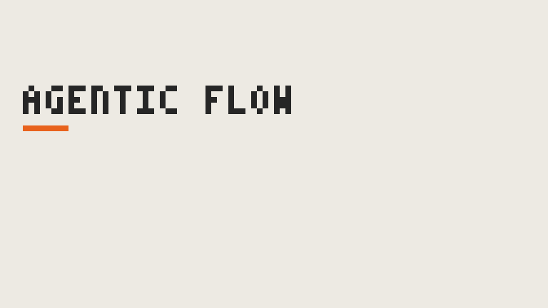

# agentic-flow

Flow agéntico para Claude Code: un arquitecto (último Opus) define `architecture.md`, varios implementadores desarrollan en paralelo usando solo ese documento y un agente QA decide qué probar y valida el resultado.

<p align="center">
  
</p>

**Guías por entorno:** [docs/how-to/](docs/how-to/README.md) (Desktop, VS Code, terminal, JetBrains, web/iOS, GitHub Actions).

```
.claude/commands/architect.md    → /architect   (último Opus)
.claude/commands/implement.md    → /implement   (orquestador, último Sonnet: olas + integración + QA)
.claude/commands/qa.md           → /qa          (solo QA, último Sonnet)
.claude/agents/implementer.md    → subagente    (último Sonnet, uno por WP)
.claude/agents/qa.md             → subagente    (último Sonnet)
.claude/bin/agentic.py           → guardarraíles y lanzador paralelo
.claude/settings.json            → hook PreToolUse y reglas allow/deny
```

## Uso

1. `/architect <qué quieres desarrollar o mejorar>`: entrevista por rondas y escribe `architecture.md` con un manifiesto `json wp-manifest`.
2. Revisa y aprueba `architecture.md`.
3. `/implement`: lanza las olas (cada WP de una ola en paralelo), integra y pasa QA.

Requisitos: macOS, Linux o WSL 2; `python3` ≥ 3.9; `git`; y el CLI de Claude Code actualizado (`curl -fsSL https://claude.ai/install.sh | bash`). Los alias `opus` y `sonnet` apuntan a los modelos más recientes que conoce tu versión.

## Paralelismo

- **Modo A (CLI `claude` en el `PATH`):** `agentic.py run-wave N` lanza un `claude -p --agent implementer --model sonnet` por WP, todos a la vez y sin conectores MCP. El paralelismo es real y no depende del modelo.
- **Modo B (sin CLI):** el orquestador lanza los subagentes con varias llamadas a Agent en un mismo mensaje.

**Modelos:** el arquitecto usa **siempre el último Opus** (alias `opus`), y el orquestador, los implementadores y QA, **siempre el último Sonnet** (alias `sonnet`). Claude Code resuelve cada alias al modelo más reciente que conoce. No se pueden cambiar por configuración, y `validate` falla si algún comando (`/architect`, `/implement`, `/qa`) o agente orquestado declara otro modelo. Para recibir un modelo nuevo en cuanto salga, mantén Claude Code actualizado.

## Guardarraíles

| Qué | Cómo |
|---|---|
| Cada WP solo escribe sus ficheros; QA solo escribe en `qa/` | Hook `PreToolUse` sobre Write/Edit, contra el manifiesto |
| Sin git, sin dependencias nuevas, sin lanzar otras sesiones de Claude | Hook `PreToolUse` sobre Bash, dentro de un WP o de QA |
| Sin push ni borrados masivos | `permissions.deny` en `settings.json`, para todos |
| Comandos permitidos mínimos | `allow_bash` del manifiesto (modo A) |
| Comprobación de propiedad al cerrar cada etapa | `snapshot` + `check-wave`: cualquier fichero cambiado fuera de su propietario hace fallar la etapa |
| Manifiesto coherente | `validate`: propietarios únicos (QA incluido), olas y dependencias |

Limitación: un agente podría escribir con Bash (`echo > fichero`) saltándose el hook de Write. En modo A solo puede ejecutar los comandos de `allow_bash`, y en los dos modos `check-wave` lo detecta al cerrar la etapa.

## En otros proyectos

- Proyecto nuevo: "Use this template" en GitHub.
- Proyecto existente: copia `.claude/` y la línea `.claude/state/` del `.gitignore` y haz commit en la rama que vayas a usar (las sesiones de iOS solo ven lo commiteado).
