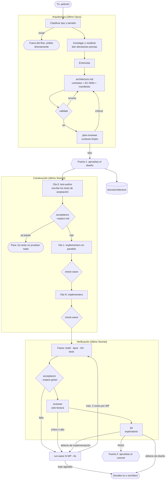
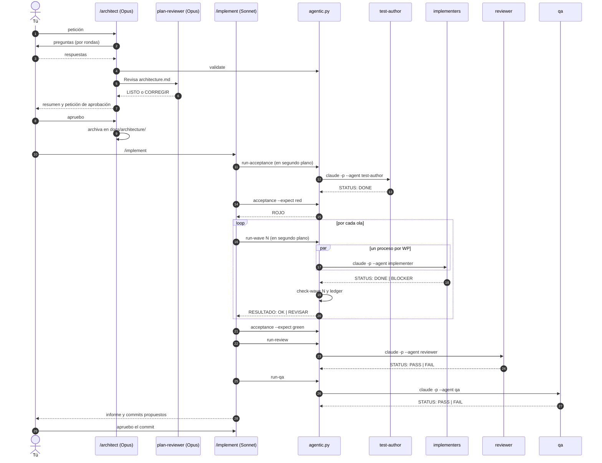
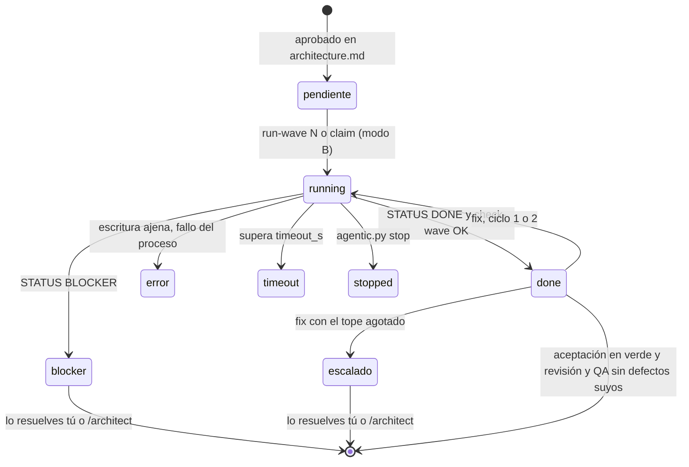
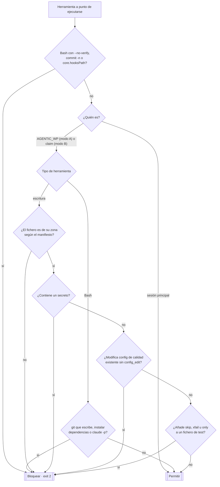
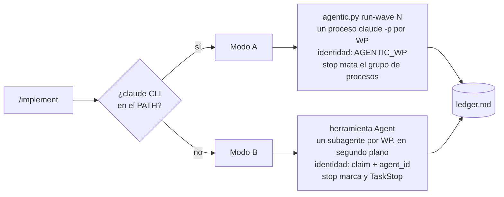

# Cómo funciona agentic-flow

Referencia técnica del flow: qué piezas hay, en qué orden actúan, quién puede escribir qué y dónde intervienes tú. Para usarlo en tu entorno, consulta los [how-to](how-to/README.md).

Contenido:

1. [Vista general](#1-vista-general)
2. [Secuencia de una ejecución](#2-secuencia-de-una-ejecución-modo-a)
3. [Ciclo de vida de un work package](#3-ciclo-de-vida-de-un-work-package)
4. [Guardarraíles: decisión del hook](#4-guardarraíles-decisión-del-hook)
5. [Matriz de permisos](#5-matriz-de-permisos)
6. [Modo A y modo B](#6-modo-a-y-modo-b)
7. [Ficheros y estado](#7-ficheros-y-estado)
8. [Glosario](#8-glosario)

## 1. Vista general

Tres fases y dos puertas humanas. Cada caja es un agente o un paso determinista del script `agentic.py`.



## 2. Secuencia de una ejecución (modo A)

El orquestador no bloquea la sesión. Lanza cada etapa en segundo plano y retoma cuando llega la notificación. Las flechas discontinuas son respuestas.



## 3. Ciclo de vida de un work package

Estados tal como aparecen en el ledger (`agentic.py status`).



## 4. Guardarraíles: decisión del hook

El hook `PreToolUse` (`agentic.py hook`) se ejecuta antes de cada Write, Edit, MultiEdit, NotebookEdit y Bash. **Falla cerrado**: dentro de un agente del flow, cualquier error bloquea.



Además, al cerrar cada etapa, `check-wave` compara todos los ficheros antes y después. Cualquier cambio fuera de la zona de esa etapa la deja en `REVISAR`, incluidos los que se hicieran por Bash esquivando el hook.

## 5. Matriz de permisos

| Agente | Modelo | Escribe en | Ejecuta | No puede |
|---|---|---|---|---|
| Arquitecto (`/architect`) | último Opus | `architecture.md`, `docs/architecture/` | `agentic.py validate` | código, tests |
| plan-reviewer | último Opus | nada | nada | escribir |
| Orquestador (`/implement`) | último Sonnet | nada (solo el ledger, vía script) | `agentic.py`, comandos de la sección 3 | código, tests, commit sin tu aprobación |
| test-author (`AT`) | último Sonnet | `acceptance.files` (por defecto `acceptance/`) | `allow_bash` + comando de aceptación | código de producción |
| implementer (`WP-NN`) | último Sonnet | los `files` de su WP | `allow_bash` + comando de aceptación | ficheros ajenos, `acceptance/`, git, dependencias |
| reviewer (`REVIEW`) | último Sonnet | nada | `git diff/status/log` + `allow_bash` | escribir |
| qa (`QA`) | último Sonnet | `qa.files` (por defecto `qa/`) | `allow_bash` | código de producción |

Para todos los agentes del flow: nada de secretos, de `--no-verify`, de relajar configuración existente ni de desactivar tests. Nadie puede poseer `architecture.md`, `.claude/` ni `docs/architecture/`.

## 6. Modo A y modo B



| | Modo A | Modo B |
|---|---|---|
| Dónde | Terminal, Desktop, IDE con el CLI instalado | Nube, o sin el CLI |
| Paralelismo | Garantizado (procesos) | Depende de que el orquestador agrupe las llamadas |
| Identidad para el hook | Variable `AGENTIC_WP` | `claim` registrado por `agent_id` |
| Coste de contexto | Bajo: el orquestador solo lee resúmenes | Mayor: los informes pasan por su contexto |
| Estado probado | Pasada completa v1 y v2 con agentes reales | Pasada completa v1; v2 solo con tests |

### Experimental: workflow nativo

`.claude/workflows/agentic-wave.js` ejecuta una ola como [workflow dinámico](https://code.claude.com/docs/en/workflows) de Claude Code. Funciona así:
- **Paralelismo:** el script lanza los implementers con `parallel()`.
- **Informes:** valida cada informe contra un JSON Schema.
- **Pasos deterministas:** los delega en el agente `gatekeeper` (`open-wave` y `close-wave`), porque un workflow no tiene acceso a la shell.

Ya está probado con agentes reales: dos olas con paralelismo efectivo, hook activo dentro del workflow (bloqueo de una escritura ajena) y ledger cerrado al terminar. Todavía no está conectado a `/implement`.

En Pro hay que activar **Dynamic workflows** en `/config`, o poner `"enableWorkflows": true` en la configuración.

## 7. Ficheros y estado

```
.claude/
├── commands/
│   ├── architect.md        /architect   (último Opus)
│   └── implement.md        /implement   (último Sonnet)
├── agents/
│   ├── plan-reviewer.md    último Opus, solo lectura
│   ├── test-author.md      ola 0
│   ├── implementer.md      un WP
│   ├── reviewer.md         solo lectura
│   └── qa.md               exploratorio
├── bin/
│   ├── agentic.py          validate · run-* · acceptance · check-wave · status · stop · hook
│   └── test_agentic.py     tests del propio flow
├── settings.json           hook PreToolUse + permisos
├── agentic.json            timeout_s · auth · max_fix_cycles
└── state/                  (ignorado por git)
    ├── ledger.md           estado legible
    ├── runs/<ID>.json      informe de cada agente
    └── snapshot-*.json     huellas para check-wave
architecture.md             el contrato vigente
docs/architecture/          diseños aprobados + índice de decisiones
acceptance/  qa/            tests de aceptación y de QA
```

## 8. Glosario

- **WP (work package):** unidad de trabajo con ficheros propios, asignada a un implementer.
- **Ola:** grupo de WP que corren en paralelo. Una ola solo depende de olas anteriores.
- **AC-NNN:** criterio de aceptación observable, con su "no debe" y su verificación automática.
- **Ola 0:** el test-author convierte los AC en tests antes de que exista el código.
- **Manifiesto:** bloque `json wp-manifest` de `architecture.md` del que leen todos los guardarraíles.
- **Ledger:** `.claude/state/ledger.md`, el estado de agentes y etapas. Lo escribe el script, no el modelo.
- **check-wave:** comparación de huellas antes y después de una etapa para detectar escrituras fuera de zona.
- **Puertas humanas:** aprobar el diseño y aprobar el commit. Nada pasa de una fase a otra sin ti.
