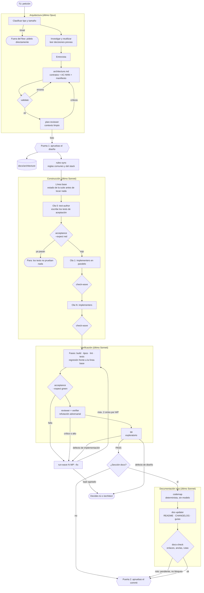
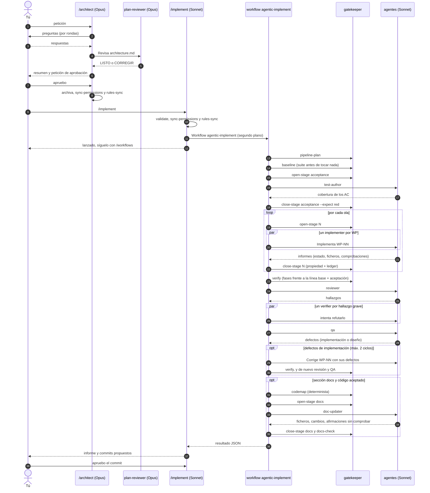
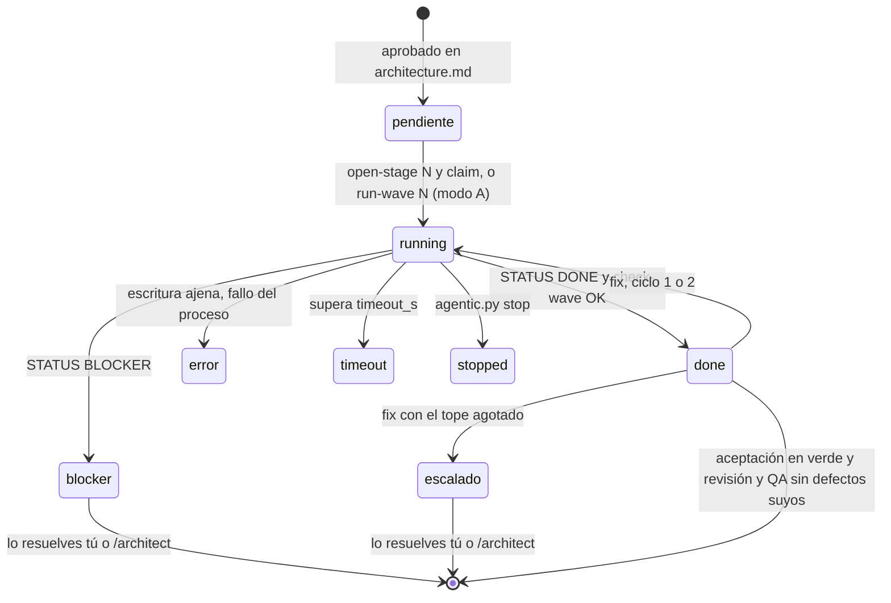
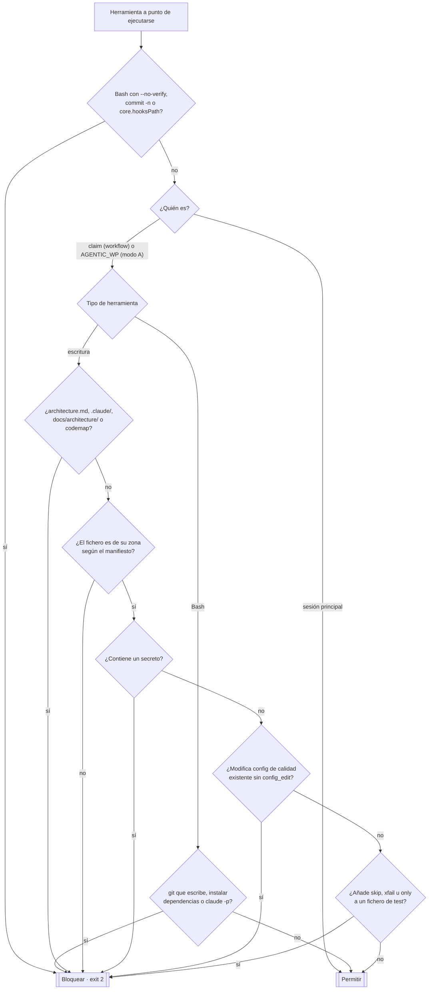
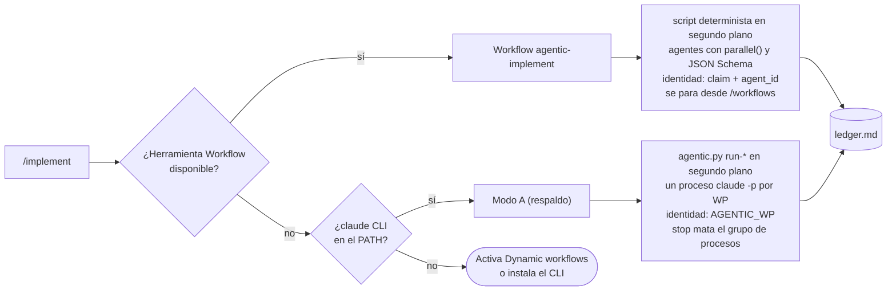

# Cómo funciona agentic-flow

Referencia técnica del flow: qué piezas hay, en qué orden actúan, quién puede escribir qué y dónde intervienes tú. Para usarlo en tu entorno, consulta los [how-to](how-to/README.md).

Contenido:

1. [Vista general](#1-vista-general)
2. [Secuencia de una ejecución](#2-secuencia-de-una-ejecución)
3. [Ciclo de vida de un work package](#3-ciclo-de-vida-de-un-work-package)
4. [Guardarraíles: decisión del hook](#4-guardarraíles-decisión-del-hook)
5. [Matriz de permisos](#5-matriz-de-permisos)
6. [Workflow nativo y modo A](#6-workflow-nativo-y-modo-a)
7. [Ficheros y estado](#7-ficheros-y-estado)
8. [Glosario](#8-glosario)

## 1. Vista general

Cuatro fases y dos puertas humanas. Cada caja es un agente o un paso determinista del script `agentic.py`.



## 2. Secuencia de una ejecución

`/implement` valida y lanza el workflow nativo `agentic-implement`, que corre en segundo plano. El script decide qué viene después; los pasos deterministas los ejecuta el `gatekeeper` con `agentic.py`. Las flechas discontinuas son respuestas, todas validadas contra un JSON Schema.



## 3. Ciclo de vida de un work package

Estados tal como aparecen en el ledger (`agentic.py status`).



## 4. Guardarraíles: decisión del hook

El hook `PreToolUse` (`agentic.py hook`) se ejecuta antes de cada Write, Edit, MultiEdit, NotebookEdit y Bash. **Falla cerrado**: dentro de un agente del flow, cualquier error bloquea.



Además, al cerrar cada etapa, `check-wave` compara todos los ficheros antes y después. Cualquier cambio fuera de la zona de esa etapa la deja en `REVISAR`, incluidos los que se hicieran por Bash esquivando el hook.

## 5. Matriz de permisos

| Agente | Modelo | Escribe en | Ejecuta | No puede |
|---|---|---|---|---|
| Arquitecto (`/architect`) | último Opus | `architecture.md`, `docs/architecture/` | `agentic.py validate`, `stack`, `codemap`, `sync-permissions`, `rules-sync` | código, tests |
| plan-reviewer | último Opus | nada | nada | escribir |
| Lanzador (`/implement`) | último Sonnet | nada (solo el ledger, vía script) | `agentic.py`, la herramienta Workflow | código, tests, commit sin tu aprobación |
| Workflow `agentic-implement` | n/a (script) | nada: no tiene shell ni disco | solo agentes | saltarse el orden o los topes del script |
| gatekeeper | último Sonnet | nada directamente (los comandos de `agentic.py` escriben estado) | solo `python3 .claude/bin/agentic.py …` | ejecutar cualquier otro comando |
| verifier | último Sonnet | nada | nada (solo lee) | escribir |
| test-author (`AT`) | último Sonnet | `acceptance.files` (por defecto `acceptance/`) | `allow_bash` + comando de aceptación | código de producción |
| implementer (`WP-NN`) | último Sonnet | los `files` de su WP | `allow_bash` + comando de aceptación | ficheros ajenos, `acceptance/`, git, dependencias |
| reviewer (`REVIEW`) | último Sonnet | nada | `git diff/status/log` + `allow_bash` | escribir |
| qa (`QA`) | último Sonnet | `qa.files` (por defecto `qa/`) | `allow_bash` | código de producción |
| doc-updater (`DOCS`) | último Sonnet | `docs.files` (por defecto `README.md`, `CHANGELOG.md`, `docs/`) | `git diff/status/log` | código, tests, el codemap, `docs/architecture/` |

Para todos los agentes del flow: nada de secretos, de `--no-verify`, de relajar configuración existente ni de desactivar tests. Nadie puede poseer `architecture.md`, `.claude/` ni `docs/architecture/`, y el hook impide escribirlos (y el codemap) aunque una zona los incluya por prefijo, como `docs/`.

## 6. Workflow nativo y modo A



| | Workflow nativo (principal) | Modo A (respaldo) |
|---|---|---|
| Requisito | Dynamic workflows activado (en Pro, en `/config`, o `"enableWorkflows": true`) | CLI `claude` en el `PATH` |
| Dónde funciona | CLI, Desktop, IDE, `claude -p` y nube | Donde haya CLI: terminal, Desktop, IDE |
| Orquestación | El script, de forma determinista | El lanzador, siguiendo las instrucciones de `/implement` |
| Informes | JSON validado por esquema | Texto con `STATUS:`, leído por regex |
| Revisión | Con verificación adversarial de cada hallazgo grave | Sin verificación adversarial |
| Límite de uso en Pro | El run se pausa y continúa solo (en sesión interactiva) | Los agentes en marcha fallan; se relanza a mano |
| Seguimiento | `/workflows` y el ledger | El ledger |

## 7. Ficheros y estado

```
.claude/
├── commands/
│   ├── architect.md        /architect   (último Opus)
│   └── implement.md        /implement   (último Sonnet)
├── agents/
│   ├── plan-reviewer.md    último Opus, solo lectura
│   ├── gatekeeper.md       ejecuta agentic.py para el workflow
│   ├── verifier.md         refuta hallazgos graves, solo lectura
│   ├── test-author.md      ola 0
│   ├── implementer.md      un WP
│   ├── reviewer.md         solo lectura
│   ├── qa.md               exploratorio
│   └── doc-updater.md      documentación viva, zona docs
├── workflows/
│   └── agentic-implement.js   el pipeline completo como workflow nativo
├── rules-library/          reglas comunes y de 10 lenguajes (fuente)
├── rules/agentic/          las que instala rules-sync; Claude Code carga .claude/rules/
├── bin/
│   ├── agentic.py          validate · pipeline-plan · open/close-stage · verify · stack · rules-sync · codemap ·
│   │                       docs-check · install · run-* · status · stop · hook
│   ├── test_agentic.py     tests de agentic.py, del hook y del instalador
│   ├── test_definitions.py tests de las definiciones: agentes, reglas, plugin, CI y documentación
│   └── test_workflow.mjs   tests de la lógica del workflow con agentes simulados
├── settings.json           hook PreToolUse + permisos
├── agentic.json            timeout_s · auth · max_fix_cycles
├── agentic-install.json    versión y huellas, si se instaló con el plugin
└── state/                  (ignorado por git)
    ├── ledger.md           estado legible
    ├── runs/<ID>.json      informe de cada agente
    └── snapshot-*.json     huellas para check-wave
architecture.md             el contrato vigente
docs/architecture/          diseños aprobados + índice de decisiones
docs/CODEMAP.md             mapa del código, generado (si hay sección docs)
acceptance/  qa/            tests de aceptación y de QA
.claude-plugin/  plugin/    solo en la plantilla: el plugin que instala todo lo anterior
```

## 8. Glosario

- **WP (work package):** unidad de trabajo con ficheros propios, asignada a un implementer.
- **Ola:** grupo de WP que corren en paralelo. Una ola solo depende de olas anteriores.
- **AC-NNN:** criterio de aceptación observable, con su "no debe" y su verificación automática.
- **Ola 0:** el test-author convierte los AC en tests antes de que exista el código.
- **Manifiesto:** bloque `json wp-manifest` de `architecture.md` del que leen todos los guardarraíles.
- **Ledger:** `.claude/state/ledger.md`, el estado de agentes y etapas. Lo escribe el script, no el modelo.
- **check-wave:** comparación de huellas antes y después de una etapa para detectar escrituras fuera de zona.
- **Línea base:** estado de build, tipos, lint y tests antes de tocar nada (`.claude/state/baseline.json`). Al verificar, una fase que pasaba y ahora falla es **regresión** (bloquea); una que ya fallaba es **fallo previo** (se informa, no se atribuye a ningún WP).
- **Patrones a imitar (`mirror`):** referencias `fichero:líneas` al código existente que cada WP debe imitar. `validate` comprueba que existen.
- **Puertas humanas:** aprobar el diseño y aprobar el commit. Nada pasa de una fase a otra sin ti.
- **Workflow nativo:** script de Claude Code (`.claude/workflows/`) que orquesta subagentes de forma determinista y en segundo plano. Aquí, `agentic-implement`.
- **gatekeeper:** agente que ejecuta los pasos deterministas de `agentic.py` en nombre del workflow, que no tiene shell.
- **Stack y reglas:** `stack` del manifiesto (los lenguajes del proyecto). `rules-sync` instala en `.claude/rules/agentic/` las reglas comunes y las de esos lenguajes, y el workflow pasa la lista a cada agente. Mandan, por este orden: `architecture.md`, el código existente, las reglas del proyecto y estas.
- **Documentación viva:** etapa final, solo con el código aceptado. El **codemap** (ficheros y símbolos públicos) lo genera `agentic.py`, sin modelo y sin fecha, así que solo cambia cuando cambia el código. El doc-updater actualiza lo que lee el usuario y `docs-check` comprueba enlaces, anclas y rutas.
- **Plugin:** `agentic-flow`, con un solo comando, `/agentic-flow:init`, que instala o actualiza el flow en el repo sin pisar lo que hayas modificado.
