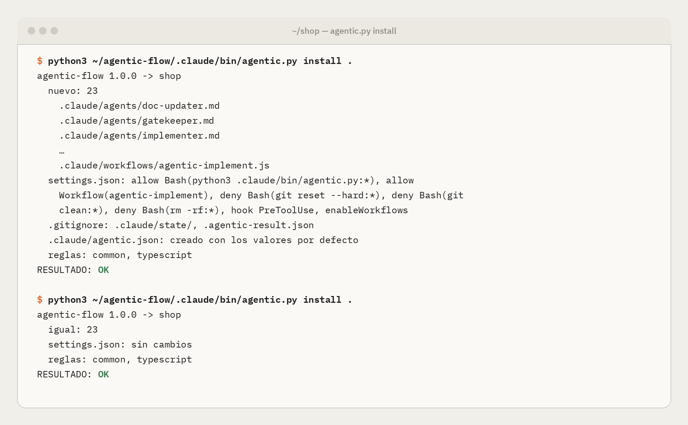

# Guide: install and update the flow with the plugin

> Reviewed on 2026-10-19 with Claude Code 2.1.302. What every environment shares is in the [guides hub](README.md).

The `agentic-flow` plugin brings the flow to an existing repo and keeps it up to date. For a new project, the template is still the fastest route (`gh repo create --template`).

## What it does, and what it doesn't

The plugin has a single command, `/agentic-flow:init`, which **copies the flow into the repo** (`.claude/`) and updates it when a new version ships. The agents, the workflow and the hook run from the repo, not from the plugin, for four reasons:

1. **Permissions and the hook.** The permissions the agents need and the guardrail hook can only be declared in the project's `settings.json`. A plugin cannot grant permissions.
2. **Names.** The workflow calls the agents by name (`implementer`, `qa`…), and a plugin would prefix them (`agentic-flow:implementer`).
3. **Team, CI and cloud.** CI, cloud sessions and your teammates need the flow even without the plugin.
4. **Reproducibility.** The flow's version stays pinned next to the code it produces.

Uninstalling the plugin does not remove the flow from the repo.

## What you need

- Claude Code 2.1.275 or later to install in one step; with older versions, use the two steps below.
- Read access to `jagosar/agentic-flow`. It is a private repo cloned with git, so your git must be able to authenticate with GitHub (for example with `gh auth login` and `gh auth setup-git`).
- `python3` 3.9+ and `git`, like the rest of the flow.

## Install

In a Claude Code session inside your repo:

```
/plugin install agentic-flow --marketplace jagosar/agentic-flow
```

Or in two steps, which also work from a terminal:

```bash
claude plugin marketplace add jagosar/agentic-flow
```

```bash
claude plugin install agentic-flow@agentic-flow
```

Then, in the session:

```
/agentic-flow:init
```

`/agentic-flow:init`:
- **Copies the flow** to `.claude/`: agents, commands, workflow, `agentic.py` and the rules library. The flow's own tests are not copied.
- **Merges your `.claude/settings.json`:** adds the permissions, the `deny` rules, the hook and `enableWorkflows`, removing nothing of yours.
- **Adds configuration:** creates `.claude/agentic.json` if missing and adds `.claude/state/` and `.agentic-result.json` to `.gitignore`.
- **Installs rules:** detects your languages and installs their rules in `.claude/rules/agentic/`.
- **Keeps a record:** stores the version and the fingerprint of every installed file in `.claude/agentic-install.json`.

`--dry-run` shows what it would do without writing anything. This is the installer's real output in a TypeScript repo, first install and a second run:

<p align="center"></p>

Then:
1. **Open a new session** in the repo and accept the trust prompt. Without it, Claude Code ignores the project's permissions.
2. **On Pro, enable Dynamic workflows** in `/config`.
3. **Commit `.claude/`.**
4. **Start** with `/architect`.

## Update

The same command installs and upgrades, whether the repo installed the flow with the plugin or was created from the template, and whatever version it has:

```bash
claude plugin update agentic-flow@agentic-flow
```

Restart the session and run `/agentic-flow:init` again (or, without the plugin, `python3 <a clone of agentic-flow>/.claude/bin/agentic.py install <repo>`). Use `--dry-run` first to see what it would do.

`init` refreshes the agents, commands, workflow, `agentic.py`, the rules library and the settings entries. Each of the flow's files ends in one of these states:

| State | What happens |
|---|---|
| new | It did not exist: copied |
| updated | Intact (its content is one the flow shipped at some point): replaced |
| unchanged | Already up to date |
| modified by you (left alone) | You edited it: kept, and the new version is saved beside it in `.claude/state/upgrade/<path>` (ignored by git). Compare with `diff -ru .claude/state/upgrade/.claude .claude`, or run again with `--force` to replace it |
| removed | The new version no longer ships it and it is intact: deleted. An edited one is never deleted |

How it knows a file is intact: the flow ships the fingerprint of every version it ever published (`.claude/flow-history.json`), and the previous install's record (`.claude/agentic-install.json`). That is why a repo created from the template, which has no record, upgrades just as safely.

What else it does:
- **Template leftovers.** The flow's own tests, CI workflow and plugin files that the template copied are updated only if they are already there and intact. If part of the flow's test suite is there, the rest of it is added, so your CI keeps passing.
- **Guards.** It writes nothing if a flow file has uncommitted changes (commit or stash them, or use `--allow-dirty`) or a run is in progress (let it finish, or run `python3 .claude/bin/agentic.py stop`). It exits with code 3 and says why. So any upgrade can be undone with git.
- **Version and notes.** The first line shows the jump between the installed flow and the new one, and `upgrade notes:` lists, release by release, what changed and may affect you (a removed command, a prompt to merge, a changed hook). Read them before you commit.
- **The hook.** For a repo whose hook entry is older, it appends `StructuredOutput` to the matcher and sets the longer timeout the stop gate needs, keeping the rest of your entry.
- **Your plan.** If the repo has an `architecture.md`, it validates it with the new version and tells you, without failing the upgrade.

Line endings do not count: a flow file checked out with CRLF (Windows with `core.autocrlf=true`) is recognised as intact and updated. A flow from before Windows support looked edited in that case and kept such files.

## Try it without installing

To try a local copy of the plugin in a single session, without touching your configuration:

```bash
claude --plugin-dir /path/to/agentic-flow
```

## Publish a version (maintainers)

A version is published by merging the pull request that bumps it: no second pull request, no release made by hand.

1. In the pull request, bump `version` in `.claude-plugin/plugin.json` (the version lives only there; the marketplace entry does not repeat it) and add its entry to `NOTES` in `.claude/bin/upgrade.py`: what changed for projects, one sentence per change. Those notes become the release's description. If the release adds its own `.claude/bin/test_acceptance_*.py`, move the previous release's unique checks into the unit suites and delete that file: only the current release's acceptance file may stay. Preview the notes with:

   ```bash
   python3 .claude/bin/agentic.py release-notes
   ```

2. As the pull request's last commit, after any update from `main`, record the flow's history so upgrades recognise this version too, and commit it. It needs a full clone, not a shallow one:

   ```bash
   python3 .claude/bin/agentic.py flow-history
   python3 .claude/bin/agentic.py flow-history --check   # what CI's history check runs: exit 0
   ```

   The `history` check of the pull request fails until you do, and again if `main` changes a shipped file afterwards: regenerate and commit once more.

3. Merge. The `agentic-flow-release` workflow checks the history again, creates the `agentic-flow--v<version>` tag on the merge commit and the GitHub release, titled `agentic-flow <version>`, with the notes of step 1. A merge that does not change the version publishes nothing.

4. If the workflow fails, fix the cause in a new pull request and publish with **Run workflow** in the repository's Actions tab, on `agentic-flow-release`. Nothing is tagged until every check passes.

CI already validates the plugin on every pull request; to check it locally, run `claude plugin validate --strict .`.

## Troubleshooting

| Symptom | Cause and fix |
|---|---|
| `/plugin install` cannot find the marketplace | The repo is private and git cannot authenticate. Set up your GitHub credentials for git and try again |
| `/agentic-flow:init` does not appear | Plugins load when a session starts: restart it after installing or updating |
| After `init`, `/architect` does not appear | Open a new session in the repo: project commands and agents load at startup |
| `modified by you` on files you don't remember touching | Their content matches no published version: line endings (`core.autocrlf`), a formatter, or a copy from an unreleased commit. Compare with `.claude/state/upgrade/` and use `--force` if nothing of yours is there |
| `install: nothing was written` (exit 3) | A flow file has uncommitted changes, or a run is in progress. Commit or stash (or `--allow-dirty`), or run `python3 .claude/bin/agentic.py stop` |
